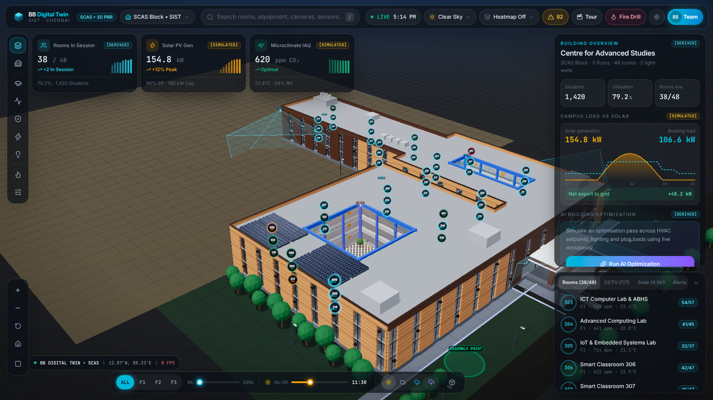
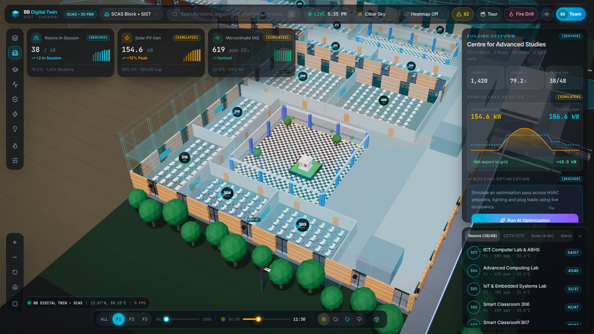
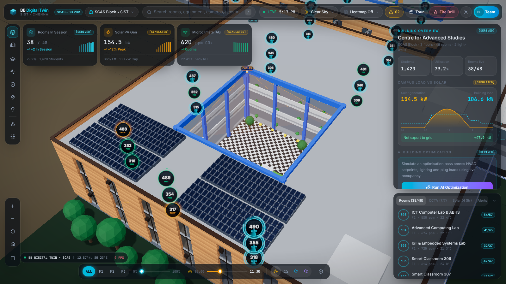
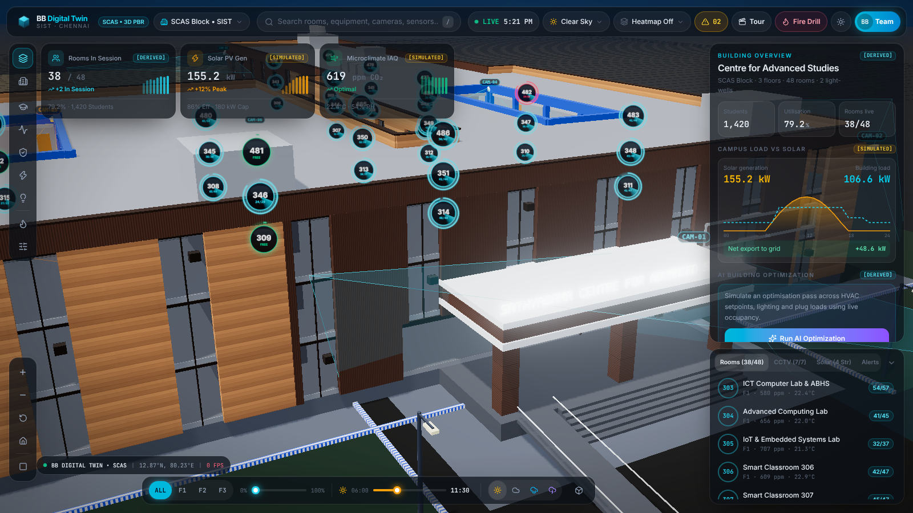
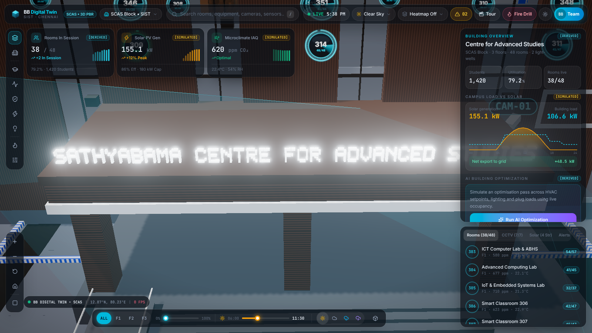
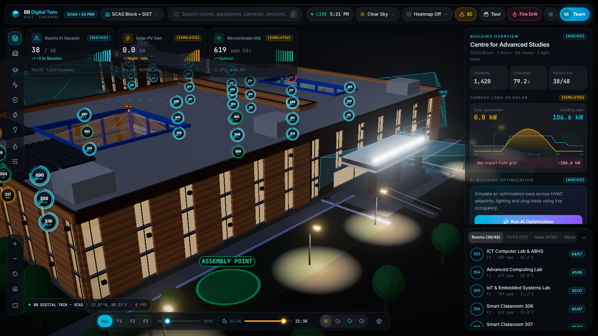

# BB DIGITAL TWIN — Sathyabama Centre for Advanced Studies (SCAS)

[](https://scas-digital-twin.vercel.app)
[](https://threejs.org/)
[](https://react.dev/)
[](https://www.typescriptlang.org/)
[](https://tailwindcss.com/)
[](https://vitejs.dev/)

🔗 **Live Production URL**: [https://scas-digital-twin.vercel.app](https://scas-digital-twin.vercel.app)  
🏛️ **Facility**: Centre for Advanced Studies (SCAS), Sathyabama Institute of Science and Technology (SIST), Chennai  
📍 **Coordinates**: `12.8718° N, 80.2253° E` (Plus Code: `V6CG+Q4H`)  
👥 **Core Engineering (BB)**:
- **Bharath Kumar** — `44733013` (3D Spatial Architecture, WebGL Shading & Interactive Pipeline)
- **Balayogi** — `44733011` (BMS Telemetry, AI Engine & Incident Simulator)

---

## 🏛️ Executive Overview

The **BB DIGITAL TWIN** is an autonomous 3D spatial command center built for the **Centre for Advanced Studies (SCAS)** at SIST Chennai. It pairs procedural PBR 3D architectural modeling with live building telemetry, microclimate indoor air quality (IAQ) monitoring, rooftop solar photovoltaic generation tracking, a CCTV surveillance matrix with verified photographic archives, and an interactive emergency evacuation drill simulator.

---

## 📸 Screenshots



| | |
| :---: | :---: |
|  |  |
| **Floor 1 · Room 303** | **Open-air courtyard** |
|  |  |
| **East entrance portico** | **Portico signage** |
|  | |
| **Night lighting** | |

---

## 🌐 Live Production Deployments

| Environment | URL | Status |
| :--- | :--- | :--- |
| **Primary Domain** | [https://scas-digital-twin.vercel.app](https://scas-digital-twin.vercel.app) | 🟢 Production Active |
| **Deployment Alias** | [https://scas-digital-twin-jcp93n97i-bharathbeasts-projects.vercel.app](https://scas-digital-twin-jcp93n97i-bharathbeasts-projects.vercel.app) | 🟢 Edge Deployed |

---

## ⚡ Tech Stack & Architecture

- **Core Framework**: React 19 + TypeScript (Strict) + Vite 8
- **3D Graphics Engine**: Three.js (Procedural PBR materials, instanced architectural geometry, directional solar ephemeris lighting, day/night cycles, shadows)
- **Styling & HUD**: Tailwind CSS v4 + Dark Architectural Glassmorphism
- **Iconography**: Lucide React
- **Hosting & Infrastructure**: Vercel Serverless Edge

---

## 🎯 Key Features

### 1. 🏢 3D Procedural SCAS Architecture
- 3-floor procedural envelope with accurate floor heights, grand entrance portico, dual open-air atriums, and window bays generated entirely in code.
- Interactive 3-floor explosion slider (0% to 100%) and individual floor isolation filters (`ALL`, `F1`, `F2`, `F3`).

### 2. 📍 Classroom Directory & Spatial Nodes
- 48 source-derived classrooms (Rooms 303 to 490) with verified IQAC photographic archives.
- Room 303 ICT Computer Lab & ABHS guidance room with simulated BMS telemetry.

### 3. 📹 CCTV Surveillance Matrix
- 7 camera nodes (`CAM-01` through `CAM-07`) with spatial coverage frustums.
- Verified 1080p surveillance modal with IR night vision and AI bounding box detection.

### 4. ☀️ Rooftop Solar Photovoltaic Farm
- 180 kW array broken into 4 active strings (Strings A, B, C, D) with live generation curves, inverter efficiency, and 3D spatial string highlights.

### 5. 🌡️ Microclimate & IAQ Monitoring
- Volumetric spatial heatmaps for Temperature, $\text{CO}_2$, and Energy density.

### 6. 🤖 AI Building Optimization
- VRF Chiller #2 setback analysis with before/after kilowatt load comparisons.

### 7. 🚨 Emergency Evacuation Drill Simulator
- Room 345 Cyber Security Lab simulated fire/smoke incident with dynamic 3D green evacuation spline egress path.

### 8. 🎬 Guided Review Tour
- 15-step narrated cinematic presentation tour with automated camera choreography.

---

## 📊 Data Integrity & Telemetry Tagging

Every component in the command center is tagged for transparent data classification:
- `[SOURCE-DERIVED]`: Building proportions, room numbers (303–490), and room identities.
- `[SIMULATED]`: Air quality, solar output, streetlights, CCTV streams, and alerts generated dynamically in-browser.
- `[REAL]`: Rendering frame rate, local clock, and calculated astronomical sun position.
- `[DERIVED]`: Aggregates such as occupancy and energy savings.

---

## 🎮 Interactive Controls

- `/` — Quick Search
- `Esc` — Close modal or reset active spatial selection
- **During Cinematic Tour**:
  - `←` / `→` — Navigate between tour steps
  - `Space` — Pause / Resume automated tour
- **Developer Console Hooks**:
  - `bbTwin.startTour()` — Launch the cinematic tour
  - `bbTwin.startFireDrill()` — Trigger simulated fire drill egress
  - `bbTwin.store.set({ time: 1290, weather: 'storm' })` — Modify atmospheric conditions

---

## 🚀 Local Development

```bash
# 1. Clone repository
git clone https://github.com/bharathkumar-496/scas-digital-twin.git
cd scas-digital-twin

# 2. Install dependencies
npm install

# 3. Start development server
npm run dev

# 4. Build for production
npm run build
```

---

## 👥 Authors & Credits

- **Bharath Kumar** — [@bharathkumar-496](https://github.com/bharathkumar-496)
- **Balayogi** — SIST Chennai

*Built as an advanced engineering project at Sathyabama Institute of Science and Technology (SIST), Chennai.*
